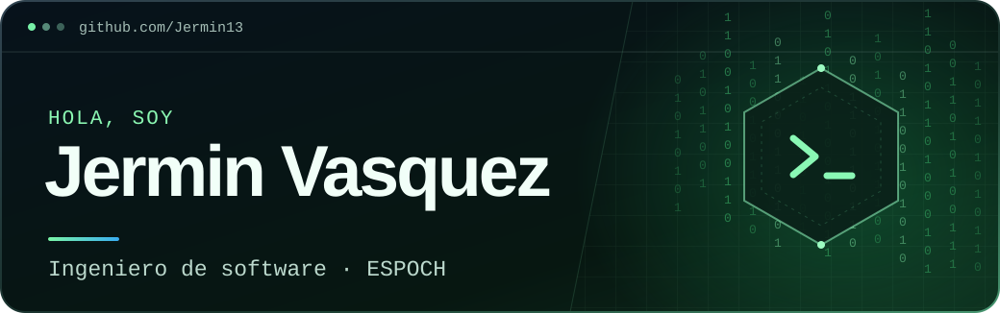

<h1 align="center">
  
</h1>

<strong>Desarrollo full stack · Inteligencia de negocios · Automatización con IA</strong>

  
  
  
  

## Impacto en producción

Construyo aplicaciones web, paneles de datos y automatizaciones a partir de las necesidades de cada equipo.

- **De 3 días a 45 segundos.** Ese fue el cambio en el tiempo de generación de reportes de carga tras automatizar el proceso en Swissport EMSA.
- **Más de 2.000 empleados.** Digitalicé procesos de recursos humanos con una plataforma web corporativa.
- **IA con modelos locales.** Implementé un servidor MCP con Node.js y Ollama para identificar clientes potenciales a partir de correos procesados localmente.

## Proyectos destacados

- **La Hueca del Sabor Online** · Diseñé una arquitectura de microservicios para gestionar pedidos, inventario y pagos como proyecto de titulación. Utilicé Node.js, Express, PostgreSQL y Redis.
- **[Plantilla de portafolio](https://github.com/Jermin13/Jermin13.github.io)** · Proyecto público con React, Vite y Tailwind CSS, con modo oscuro y soporte en español e inglés.

## Lenguajes y herramientas

  
  
  
  
  
  
  
  
  
  
  

- **Desarrollo web.** Python, Django, Django REST Framework, JavaScript, React, Node.js y Express.
- **Datos y BI.** PostgreSQL, SQL Server, ETL, modelado dimensional, Chart.js, Celery y Redis.
- **Automatización y despliegue.** MCP, Ollama, Docker, Git y GitHub Actions.

## Actividad en GitHub

  
  

Me interesa colaborar en proyectos de código abierto sobre desarrollo web, datos y automatización. Puedes [explorar mis repositorios](https://github.com/Jermin13?tab=repositories) y darles una estrella si alguno te resulta útil.

<em>«La verdad nos hace libres»</em>

